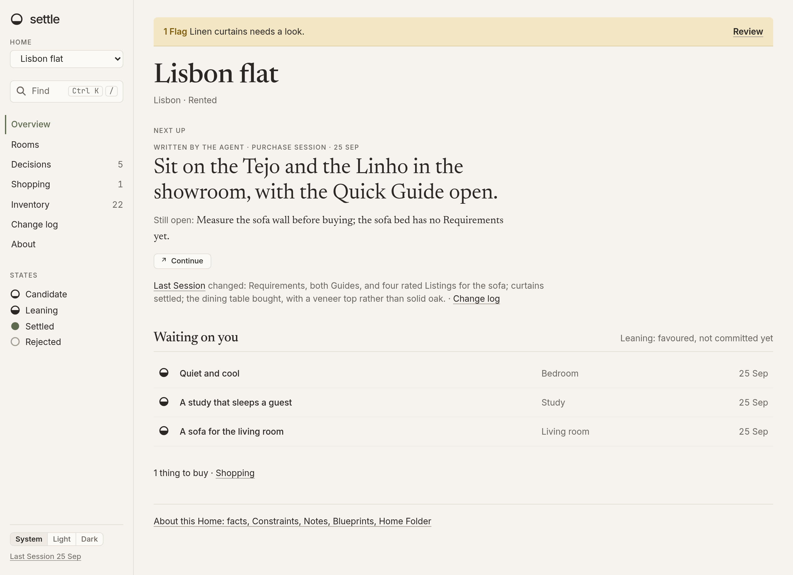
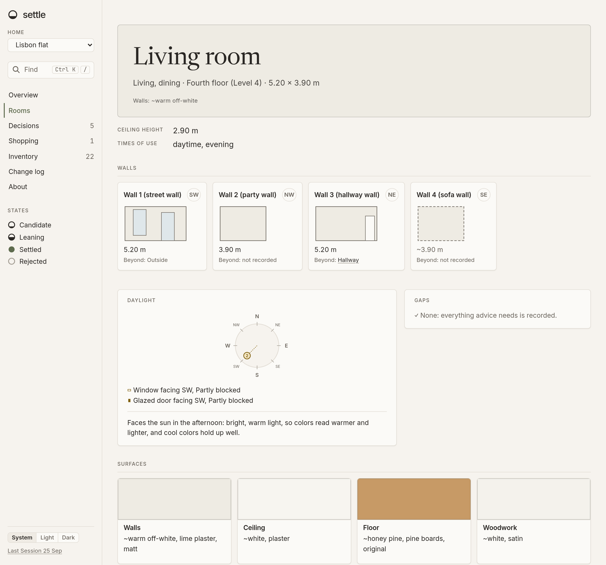
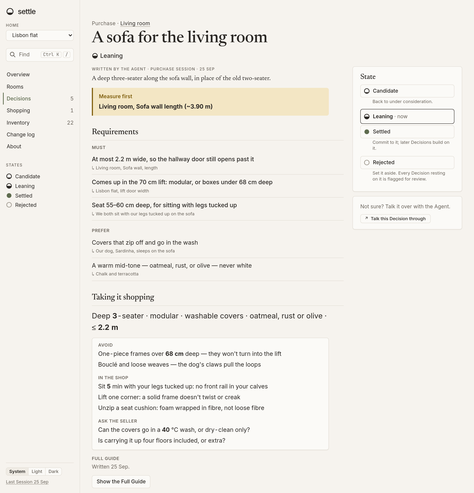

# Settle

Settle keeps a detailed record of your home — every room, how long each wall is and which way it
faces, where the windows and doors are, everything you own — and helps you decide how to furnish it
by talking it through with Claude. Each choice is a Decision you can settle, and later advice builds
on the ones you've settled. When you're buying something, it writes down what the thing has to fit
and why, then gives you a Quick Guide to take into the shop.

It runs as a small server on your own computer or your own server, with an MCP endpoint your own
Claude session works through.







## Install

Needs Node 26+, pnpm 12+ and [Claude Code](https://claude.com/claude-code).

```sh
pnpm install && pnpm build && pnpm start
```

The first start prints a setup link, `http://127.0.0.1:4380/setup/…`: open it and make your
account, with an email and a password. Create a Home, then open its About page: it gives you the
command to set up a folder for that Home. In that folder, add the plugin and run `claude` there.

```sh
claude plugin marketplace add alexzfe/settle
claude plugin install settle@settle --scope project
```

To look around before entering your own home, create a Home called "Lisbon flat" and seed the demo
from the screenshots:

```sh
SETTLE_EMAIL=you@example.com SETTLE_PASSWORD='your password' \
  node scripts/seed-demo-home.mjs http://127.0.0.1:4380/mcp/homes/lisbon-flat
```

## Use Settle in Claude

Settle connects to Claude as a custom connector, on any Claude plan, Free included. Connect it once
and it is there on the web, in the desktop and phone apps, and in Claude Code; every chat can use
any of your Homes.

1. Log in to Settle and click **Connect Settle to Claude**: it is on your account page, and right
   after you name your first Home.
2. Claude opens with Settle's name and address filled in. Click **Add**.
3. Click **Connect**.
4. Settle asks whether Claude may use your account. Click **Allow**, and log in if it asks.
5. Back in Claude, switch Settle on for a chat (**+**, then **Connectors**) if it isn't already.

Your account page lists each Connection, with **Disconnect** to end it. In Claude Code, the same page
gives one command that adds the connector for every folder, with the plugin.

Claude connects from Anthropic's servers, not from your computer, so this needs Settle on a server
reachable from the internet over HTTPS ([SELF-HOSTING.md](SELF-HOSTING.md)). A Settle on
`127.0.0.1` works only with Claude Code on the same computer.

## On a server

Run locally as above, Settle listens on `127.0.0.1` only. Everyone logs in with their own account,
locally too, and one account never sees another's Homes. To run it on a server for your household
or a few others, use the Docker image and follow [SELF-HOSTING.md](SELF-HOSTING.md): you invite
each person, and it needs HTTPS in front.

## Notes

- Lengths are shown and entered in metres and centimetres only. Storage is millimetres, and Claude
  converts either way: tell it a wall is 12'6" and it records 3810 mm.
- The words used here and in the app — Home, Decision, Requirement, Quick Guide — are defined in
  [CONTEXT.md](CONTEXT.md).

## Licence

[AGPL-3.0-or-later](LICENSE). Bug reports and ideas are welcome as issues. Pull requests are not
accepted.
